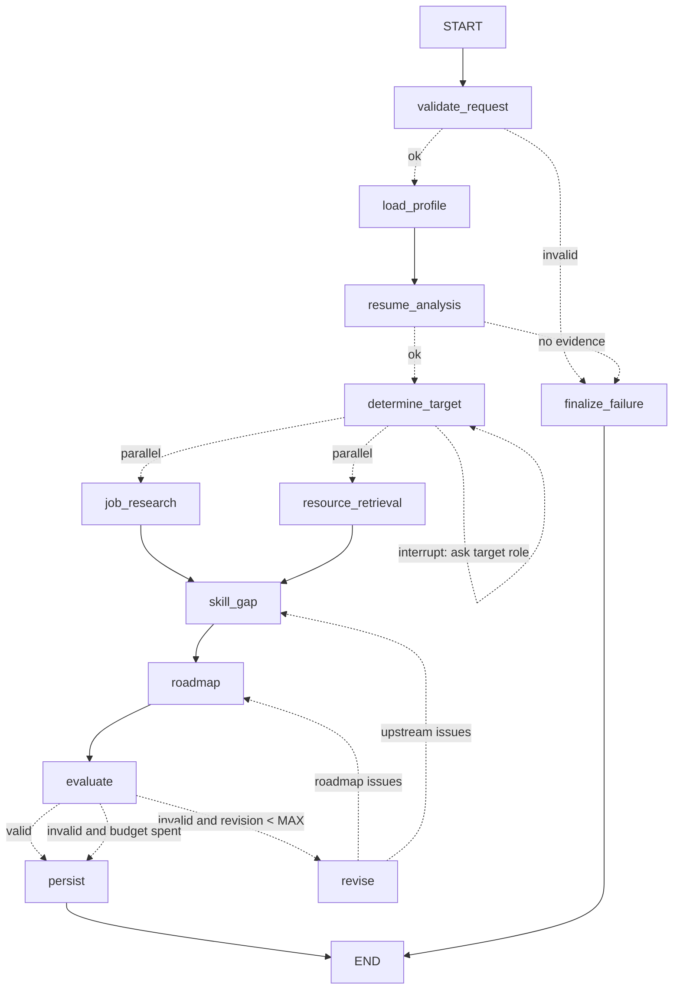
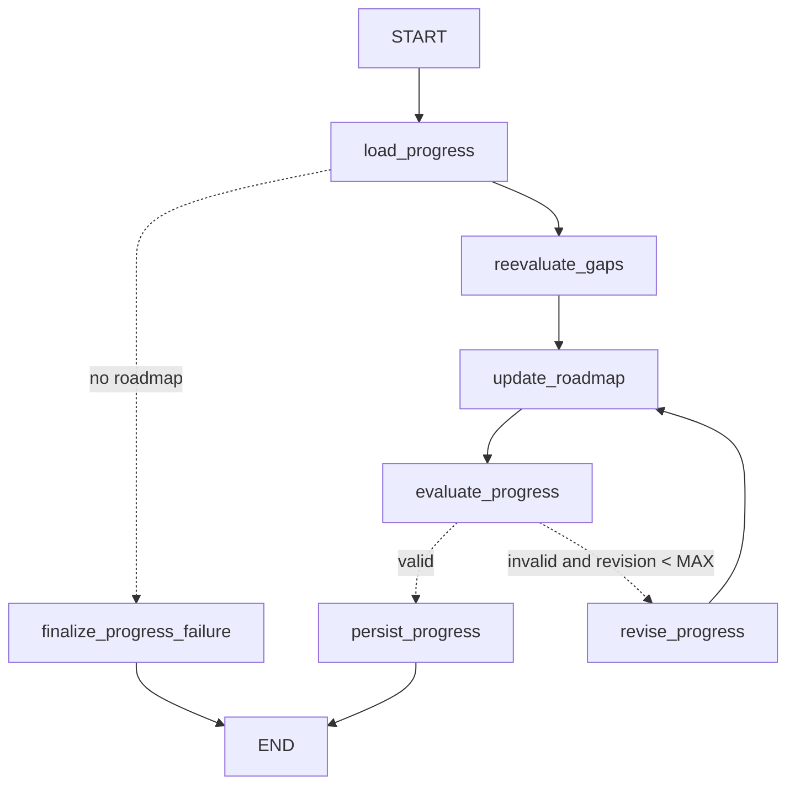
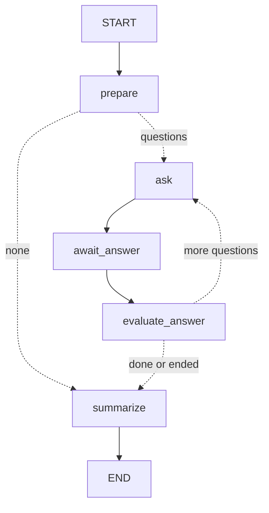

# Agents and workflows

Inspect the compiled graphs at any time with `python -m app.cli graph career|progress|interview`
or `GET /api/workflows/graph/{kind}` (Mermaid).

## Agents

| Agent | Module | Input → output | Deterministic core | LLM role (optional) |
|---|---|---|---|---|
| Career Orchestrator | `graph/career_graph.py` | request → persisted results | Routing, parallel fan-out/join, bounded revision, persistence | — |
| Resume Analysis | `agents/resume_agent.py` | resume text → `ResumeAnalysis`, `ResumeTailoring` | Section detection, taxonomy matching with evidence levels, date-range parsing, overlap-merged years, missing-info and unclear-claim checks | Extra skills/achievements, accepted only with verbatim quotes |
| Job Research | `agents/job_research_agent.py` | role + preferences → normalized, deduplicated, flagged, ranked jobs | Provider fan-out with failure isolation, requirement extraction, dedupe by id and fingerprint, quality flags, `services/matching.py` scoring | — |
| Skill Gap Analysis | `agents/skill_gap_agent.py` | candidate skills + top job requirements → `SkillGapReport` | Demand aggregation blended with a role baseline, credit by evidence, transparent priority formula | — |
| Learning Roadmap | `agents/roadmap_agent.py` | gaps + constraints + resources → `RoadmapPlan` | Two-pass fair-share allocation, per-skill cap, evidence-shaped tasks, day packing, replan parameters | — |
| Interview Coach | `agents/interview_agent.py` | question + answer/code → `AnswerEvaluation`, session summary | Gap-targeted question selection, concept-group rubrics, sandboxed tests, hint penalty, follow-ups | Criterion credit, accepted only with verbatim quotes |
| Career Evaluation | `agents/evaluation_agent.py` | all outputs → `EvaluationReport` | Evidence, contradiction, traceability, coverage, capacity, deadline and resource checks; readiness | — |

### Scoring formulas

**Skill credit** (`services/matching.py`): assessed in CareerPilot = score/100. Demonstrated 0.90,
user-asserted 0.70, listed 0.55, inferred 0.35, related skill only 0.5 × that skill's credit,
missing 0. Credit ≥ 0.75 counts as *matched*; anything above 0 is *partial*. A keyword listed in a
skills section can therefore never be a full match.

**Job match:** `skill = 100·(Σ w·credit + 2·0.5)/(Σ w + 2)`, with w = 1.0 for required and 0.4 for
preferred. The pseudo-weight shrinks sparse listings toward neutral. Experience is proportional to
the required years, preferences subtract penalties for arrangement/location/salary mismatch, and
recency decays after 7 days. `overall = 0.60·skill + 0.15·experience + 0.15·preference + 0.10·recency`.

**Gap priority** (`agents/skill_gap_agent.py`):
- `demand_share = 0.7·share_of_top_jobs + 0.3·role_baseline` (baseline 1.0 for role-required, 0.5 for role-preferred)
- `importance = level_weight·√demand_share`, with level_weight 1.0 required / 0.5 preferred
- `severity = 1 − credit`
- `urgency = 1 + 0.5·tightness` for required, `1 − 0.3·tightness` for preferred, where `tightness = clamp((12 − weeks)/12)`
- `effort = 1 − 0.3·min(1, hours_needed / (0.5·capacity))`
- `priority = 100·importance·severity·urgency·effort`

Components are rounded before multiplying, so the displayed priority is exactly reproducible.

**Readiness** (`agents/evaluation_agent.py`): 0.40 skill coverage + 0.20 evidence strength + 0.25
latest assessment scores + 0.15 plan progress. Components with no data yet are excluded and the
remaining weights renormalized, with the reason stated. Readiness is explicitly **not** an offer
probability.

## Career analysis graph

| Node | Does | Failure handling |
|---|---|---|
| `validate_request` | Checks hours/deadline ranges and that a profile exists | Fatal error → `finalize_failure` |
| `load_profile` | Builds constraints (hours, days, deadline, default 12 weeks with a warning) | DB retry policy (3×) |
| `resume_analysis` | Reuses a stored analysis or runs the Resume Agent and persists it | No resume and no skills → fatal |
| `determine_target` | Resolves the role template; **`interrupt()`** for clarification if missing | Empty answer → fatal |
| `job_research` | Providers in parallel, upsert listings (with embeddings), rank, save matches | Provider errors are recorded as non-fatal; falls back to cached listings |
| `resource_retrieval` | Seeds the catalog, retrieves resources per role skill via **pgvector cosine distance** | DB retry |
| `skill_gap` | Joins both branches; builds demand from top 10 matches (excluding suspicious listings) | DB retry |
| `roadmap` | Plans with revision-tuned parameters; retrieves resources for any extra gap skills | — |
| `evaluate` | Career Evaluation Agent | DB retry |
| `revise` | Converts errors into parameter changes (force uncovered top gaps, lower per-skill cap) | Bounded by `MAX_REVISION_LOOPS` (default 2) |
| `persist` | Gap snapshot, roadmap version, readiness record | Status `partial` when issues remain |

State (`graph/state.py`) uses `operator.add` reducers for `errors`, `warnings` and `revision_history`,
so both parallel branches can append safely. State never contains credentials or raw resume text.

## Progress loop graph (re-evaluate → update roadmap)

Triggered automatically when an interview session completes, or manually with "Replan with my
progress". It reuses stored job matches (no new search).
- Completed hours are subtracted.
- Skills assessed ≥ 80 are dropped as mastered.
- Skills assessed < 50 get forced remediation tasks.
- Pending tasks are marked `superseded`, with history kept.
- The roadmap version is bumped and the reason logged.

## Interview graph (independent, one thread per session)

`ask` persists the question, and `await_answer` contains only `interrupt()`, so resuming never
duplicates side effects. A weak criterion that has follow-up text queues one follow-up question
(at most 2 per session). `summarize` writes per-skill `AssessmentResult` rows. These feed the
skill-credit function above, which is how interview performance changes future recommendations.
